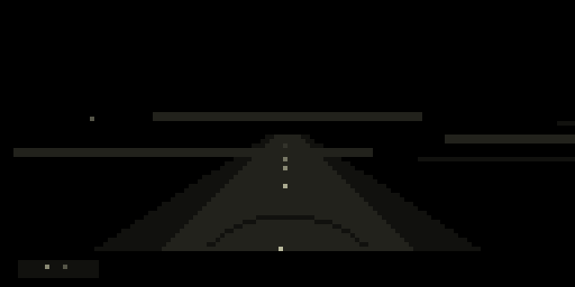
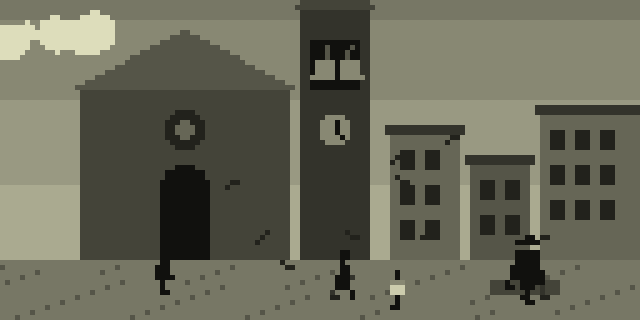

# ANAMNESI

*un luogo moderatamente sicuro*

**Italiano** · [English](#english)

Anamnesi è un viaggio dentro i ricordi: quelli veri e quelli immaginati.

Si comincia di notte, su una strada, davanti a una casa con una finestra accesa. Poi una porta si apre, e sei sulla soglia: il fuoco alle spalle, davanti tutti i sentieri. In alto c'è la quiete. In basso tutto il resto.

Ogni luogo è un piccolo mondo vivo. Qualcuno ci abita: si siede, si alza, guarda fuori dalla finestra, parla piano a chi non c'è più. E ogni luogo ha la sua musica, che non si ripete mai uguale. Un tema attraversa tutto il viaggio e riaffiora dove meno te lo aspetti.

Puoi camminare, oppure puoi restare. Restare è un modo di andare: alcuni sentieri si aprono soltanto a chi si ferma abbastanza a lungo. Uno di questi non finisce mai.

Tra un luogo e l'altro c'è un piccolo film: un cartello col numero del capitolo, poi due inquadrature con lui dentro. Una strada di notte, i lampioni sotto la pioggia, un ponte al tramonto, scale che salgono verso la luce e scale che scendono nel buio, una bicicletta tra i pioppi, una finestra accesa con i nonni a tavola.

 

 

**Sette strati, centocinquantaquattro luoghi**, dal mare di stelle al fondo dell'abisso: il cielo, le alture, l'infanzia, il paese, le case, la mente, l'abisso. E poi i luoghi che non sono sulla mappa.

**Come si cammina**

| | |
|---|---|
| **K2** | scegli il sentiero |
| **K3** | cammina (durante il viaggio: salta l'episodio) |
| **E1 E2 E3** | le tre macro del luogo: ogni luogo ha le sue |
| **K1 + K2** | evoca: gli archi si alzano, torna il tema, il luogo dice un'altra frase |
| **K1 + K3** | ora / allora: la scena diventa una vecchia fotografia, il tempo rallenta, lui torna bambino |
| **K1 + E1** | volume |
| **K1 + E2** | scorri i sentieri |
| **K1 + E3** | spazio |

Niente cambia di colpo. Il manuale completo è in [doc/manuale_it.pdf](doc/manuale_it.pdf).

**Installazione** da maiden: `;install https://github.com/unluogomoderatamentesicuro/anamnesi`, poi **SYSTEM > RESTART** (al primo avvio e dopo ogni aggiornamento del motore audio).

 

---

**English**

Anamnesi is a journey into memories: the real ones and the imagined ones.

It begins at night, on a road, before a house with one lit window. Then a door opens, and you stand on the threshold: the fire behind you, every path ahead. Above lies the quiet. Below, everything else.

Each place is a small living world. Someone lives there: sits, gets up, looks out of the window, talks softly to someone who is gone. And each place has its own music, never quite the same twice. A theme runs through the whole journey and resurfaces where you least expect it.

You can walk, or you can stay. Staying is a way of going: some paths open only to those who linger long enough. One of them never ends.

Between one place and the next there is a short film: a title card with the chapter number, then two shots with him in it. A road at night, streetlights in the rain, a bridge at sunset, stairs climbing towards the light and stairs going down into the dark, a bicycle among the poplars, a lit window with the grandparents at the table.

 

**Seven layers, a hundred and fifty-four places**, from the sea of stars to the bottom of the abyss: the sky, the heights, childhood, the village, the houses, the mind, the abyss. And then the places that aren't on the map.

**How to walk**

| | |
|---|---|
| **K2** | choose a path |
| **K3** | walk (during a journey: skip the episode) |
| **E1 E2 E3** | the place's three macros: each place has its own |
| **K1 + K2** | evoke: the strings rise, the theme returns, the place says another sentence |
| **K1 + K3** | now / back then: the scene becomes an old photograph, time slows, he becomes a child again |
| **K1 + E1** | volume |
| **K1 + E2** | scroll through the paths |
| **K1 + E3** | space |

Nothing changes abruptly. The full manual is in [doc/manual_en.pdf](doc/manual_en.pdf).

**Install** from maiden: `;install https://github.com/unluogomoderatamentesicuro/anamnesi`, then **SYSTEM > RESTART** (on first launch and after every audio engine update).

---

*Per Massimo, per i nonni, e per chi resta.*

*un luogo moderatamente sicuro*
