# ANAMNESI

*un luogo moderatamente sicuro*

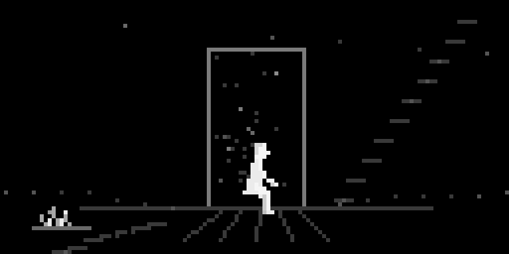

**Italiano** · [English](#english)

Anamnesi è un viaggio dentro i ricordi: quelli veri e quelli immaginati.

Si comincia di notte, in un bosco, con una lanterna in mano. In una radura c'è una porta sola, senza casa intorno: si apre, e dentro ci sono le stelle. Sei sulla soglia: davanti i sentieri, una scala di luce che sale e dei gradini che scendono nel nero. In alto c'è la quiete. In basso tutto il resto.

Ogni luogo è un piccolo mondo vivo. Qualcuno ci abita: si siede, si alza, guarda fuori dalla finestra, parla piano a chi non c'è più. E ogni luogo ha la sua canzone, un canto malinconico che torna uguale ogni volta che ci torni, raccontato in sezioni che cambiano: il tema, un'altra stanza, il culmine, il sospeso. Quando entri in un luogo lo capisci subito. Un tema attraversa tutto il viaggio e riaffiora dove meno te lo aspetti.

In molte stanze suonano gli oggetti, come in ERMO: legno, spazzole, metallo, vetro, un cuore, una macchina, ripetuti, a terzine, a quartine. E si vedono: l'ascia del boscaiolo, il martello del fabbro, le bacchette sul tamburo di latta cadono sui colpi.

Puoi camminare, oppure puoi restare. Restare è un modo di andare: alcuni sentieri si aprono soltanto a chi si ferma abbastanza a lungo. Uno di questi non finisce mai.

Lo schermo è nero, e le persone sono di luce: si vede sempre chi si muove. La macchina da presa scende sul luogo quando arrivi, segue un fiocco di neve verso il cielo, trema quando si soffre, si avvicina piano a una sedia vuota.

Tra un luogo e l'altro c'è un piccolo film: un cartello col numero del capitolo, poi due inquadrature con lui dentro. Una strada di notte, i lampioni sotto la pioggia, un ponte al tramonto, scale che salgono verso la luce e scale che scendono nel buio, una bicicletta tra i pioppi, una finestra accesa con i nonni a tavola.

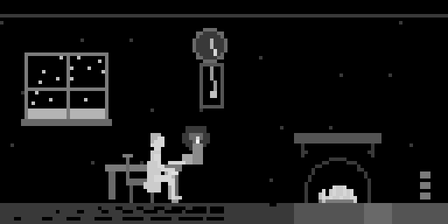 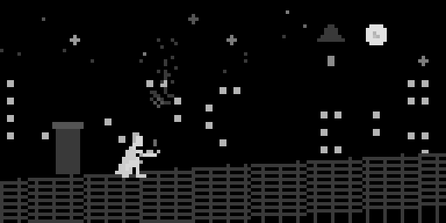

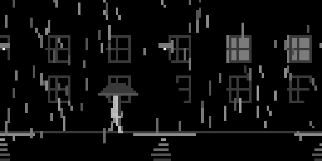 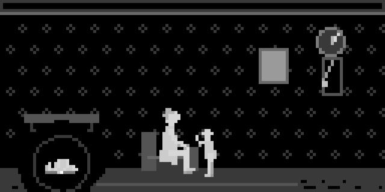

**Sette strati, trecentocinque luoghi**, dal mare di stelle al fondo dell'abisso: il cielo, le alture, l'infanzia, il paese, le case, la mente, l'abisso. E poi i luoghi che non sono sulla mappa.

Più scendi, più si soffre, e si sente: nella mente e nell'abisso la musica si sporca di rumore, di fischi nelle orecchie, di scariche, di metallo graffiato e di accordi che battono. E in certe stanze si ha fretta: una nota batte, il tempo accelera. Il panico, l'esame, la sveglia, il treno che parte, l'acqua che sale. Ma il segnale non satura mai.

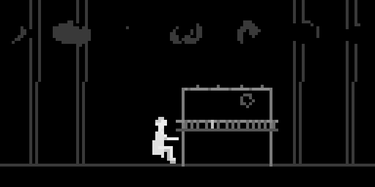 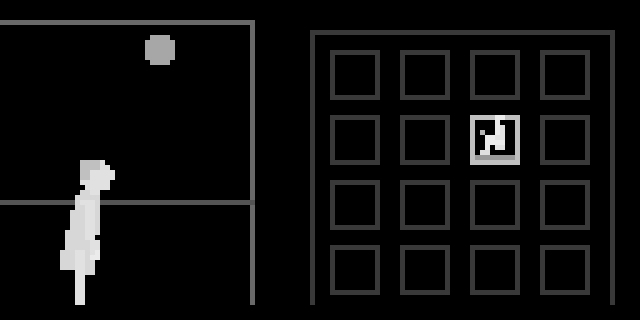

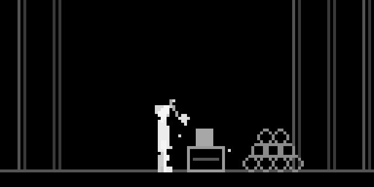 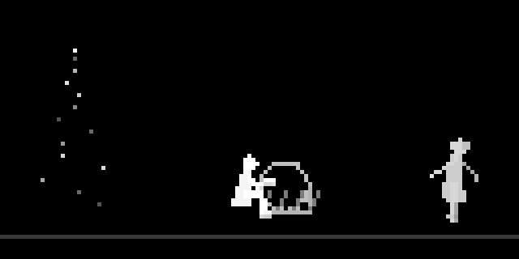

**Come si cammina**

| | |
|---|---|
| **K2** | scegli il sentiero |
| **K3** | cammina (durante il viaggio: salta l'episodio) |
| **E1 E2 E3** | le tre macro del luogo: ogni luogo ha le sue (un giro va da un capo all'altro) |
| **K1 + K2** | evoca: gli archi si alzano, torna il tema, il luogo dice un'altra frase |
| **K1 + K3** | ora / allora: la scena diventa una vecchia fotografia, il tempo rallenta, lui torna bambino |
| **K1 + E1** | volume |
| **K1 + E2** | scorri i sentieri |
| **K1 + E3** | spazio |

Niente cambia di colpo. Il manuale completo è in [doc/manuale_it.pdf](doc/manuale_it.pdf).

**Installazione** da maiden: `;install https://github.com/unluogomoderatamentesicuro/anamnesi`, poi **SYSTEM > RESTART** (al primo avvio e dopo ogni aggiornamento del motore audio).

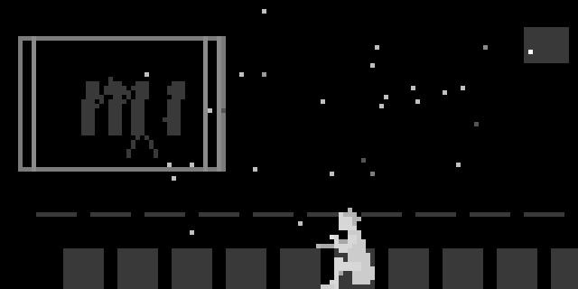 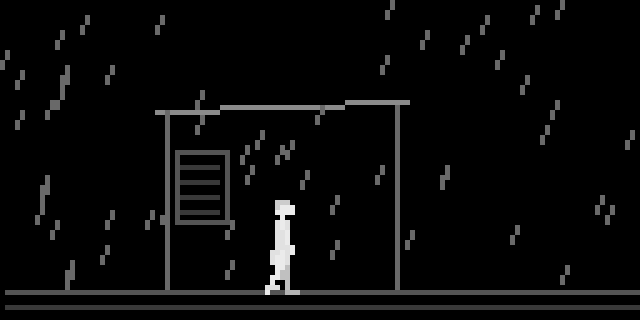

---

**English**

Anamnesi is a journey into memories: the real ones and the imagined ones.

It begins at night, in a wood, with a lantern in hand. In a clearing stands a single door, with no house around it: it opens, and inside there are stars. You are on the threshold: ahead the paths, a ladder of light going up and steps going down into the black. Above lies the quiet. Below, everything else.

Each place is a small living world. Someone lives there: sits, gets up, looks out of the window, talks softly to someone who is gone. And each place has its own song, a melancholy melody that comes back the same every time you return, told in changing sections: the theme, another room, the peak, the suspended part. When you enter a place you know it at once. A theme runs through the whole journey and resurfaces where you least expect it.

In many rooms the objects play, as in ERMO: wood, brushes, metal, glass, a heart, a machine, repeated, in triplets, in fours. And you can see them: the woodcutter's axe, the blacksmith's hammer, the sticks on the tin drum fall on the hits.

You can walk, or you can stay. Staying is a way of going: some paths open only to those who linger long enough. One of them never ends.

The screen is black, and people are made of light: you can always see who is moving. The camera cranes down onto a place as you arrive, follows a snowflake up into the sky, shakes when there is pain, moves slowly towards an empty chair.

Between one place and the next there is a short film: a title card with the chapter number, then two shots with him in it. A road at night, streetlights in the rain, a bridge at sunset, stairs climbing towards the light and stairs going down into the dark, a bicycle among the poplars, a lit window with the grandparents at the table.

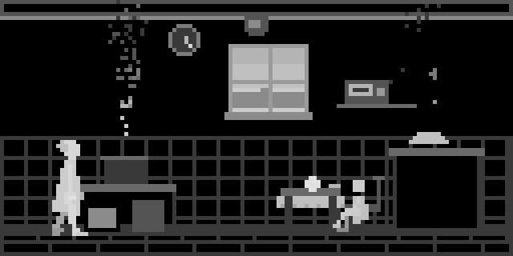 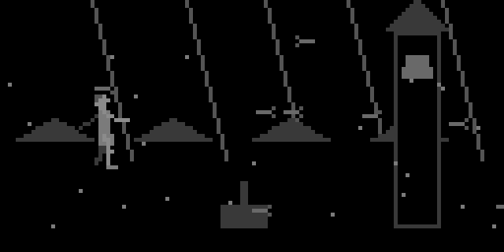

**Seven layers, three hundred and five places**, from the sea of stars to the bottom of the abyss: the sky, the heights, childhood, the village, the houses, the mind, the abyss. And then the places that aren't on the map.

The lower you go, the more it hurts, and you can hear it: in the mind and the abyss the music gets dirty with noise, ringing ears, static, scraped metal and beating chords. And in some rooms there is hurry: a note keeps beating, the tempo speeds up. The panic attack, the exam, the alarm clock, the train that's leaving, the rising water. But the signal never saturates.

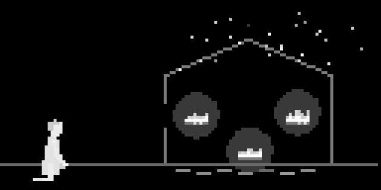 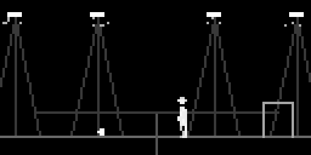

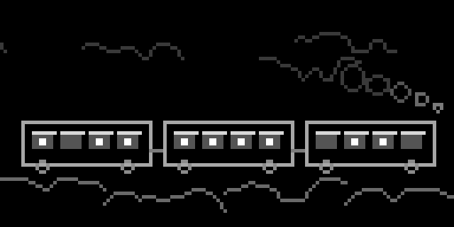 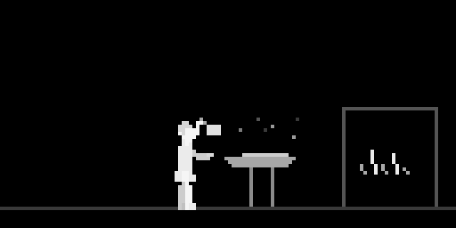

**How to walk**

| | |
|---|---|
| **K2** | choose a path |
| **K3** | walk (during a journey: skip the episode) |
| **E1 E2 E3** | the place's three macros: each place has its own (one turn goes end to end) |
| **K1 + K2** | evoke: the strings rise, the theme returns, the place says another sentence |
| **K1 + K3** | now / back then: the scene becomes an old photograph, time slows, he becomes a child again |
| **K1 + E1** | volume |
| **K1 + E2** | scroll through the paths |
| **K1 + E3** | space |

Nothing changes abruptly. The full manual is in [doc/manual_en.pdf](doc/manual_en.pdf).

**Install** from maiden: `;install https://github.com/unluogomoderatamentesicuro/anamnesi`, then **SYSTEM > RESTART** (on first launch and after every audio engine update).

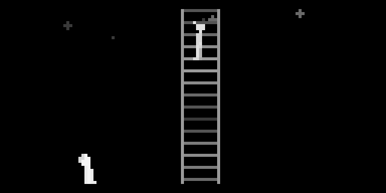 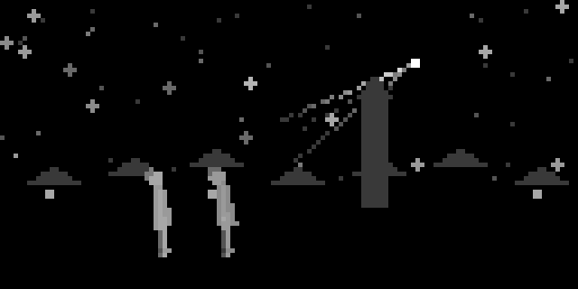

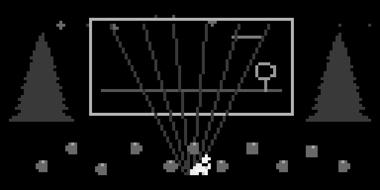

---

*Per Massimo, per i nonni, e per chi resta.*

*un luogo moderatamente sicuro*
